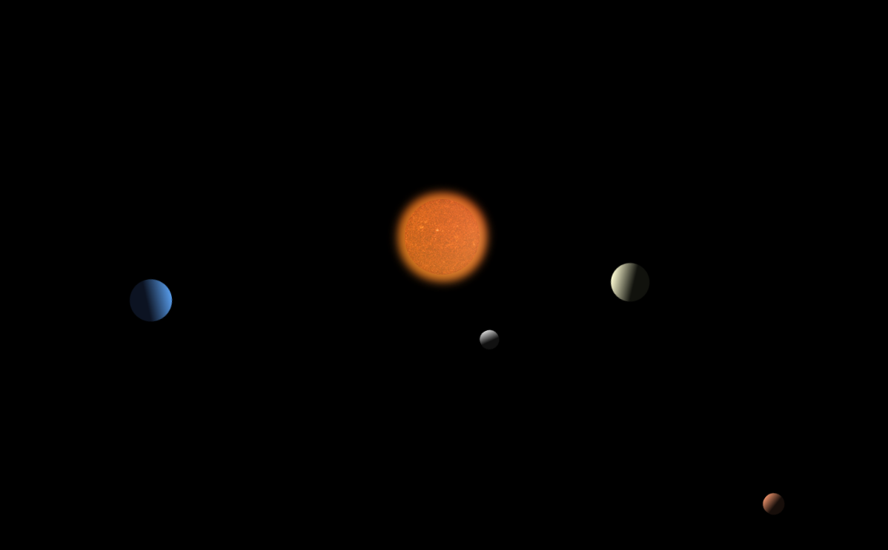

# CSS Orbits
**Live Demo:** [https://css-orbits.vercel.app](https://css-orbits.vercel.app)

## Description
An animated solar system using only HTML and CSS with no JavaScript. This started as a CSS animation experiment with the objective of making shapes go around in circles. 

## How It Works
I used a real picture of the Sun with three rotating, semi-transparent, imperfect circles over it to create a glow. Each layer has its own animation, rotating in different directions and at different speeds.

For the planets, I used linear gradients to shade the side of each planet facing away from the Sun. The `@keyframes` for each rotating element use `transform: rotate()`. To create the orbiting effect, I shifted the y-coordinate for each planet to a different negative value using `translate()`. This offsets the location of each element up from the center. When each element rotates, it circles the center with the offset as the orbit's radius. The duration of the animation for a given radius sets the speed of the orbit.

## Built With
- HTML
- CSS
- Deployed on Vercel

## Run Locally (no build or dependencies)
1. Clone the repository.
2. Open the `index.html` file in a browser.
